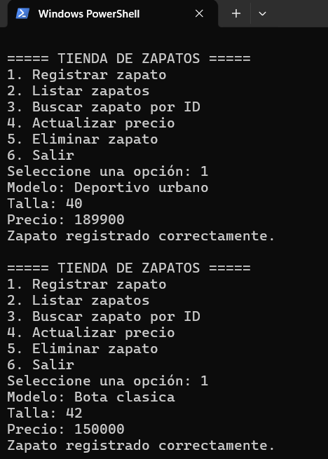
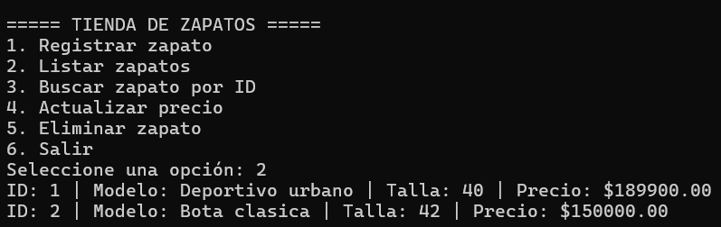
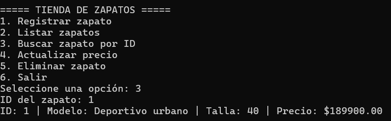
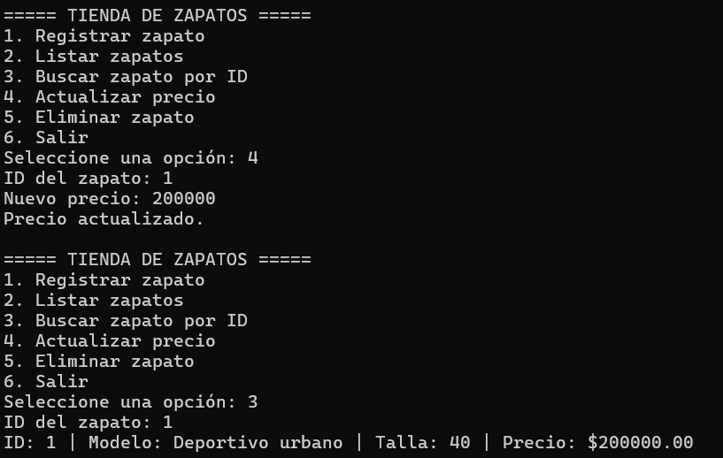
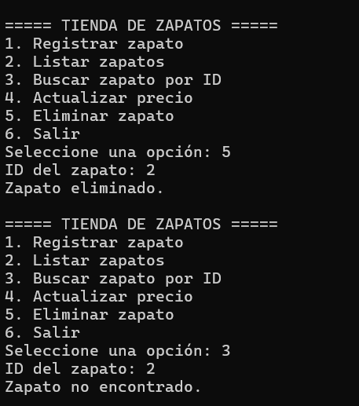
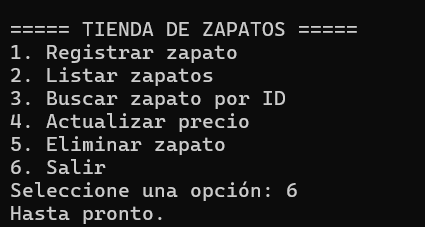
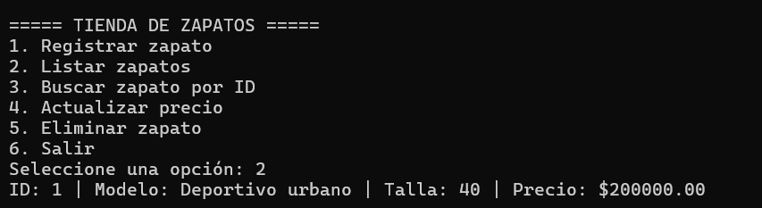

# Registrar dos zapatos diferente

#	Consultar todos los zapatos

# Buscar uno de los zapatos mediante su ID	

# Actualizar el precio de un zapato

# Eliminar un zapato

# Cerrar y volver a ejecutar el programa

